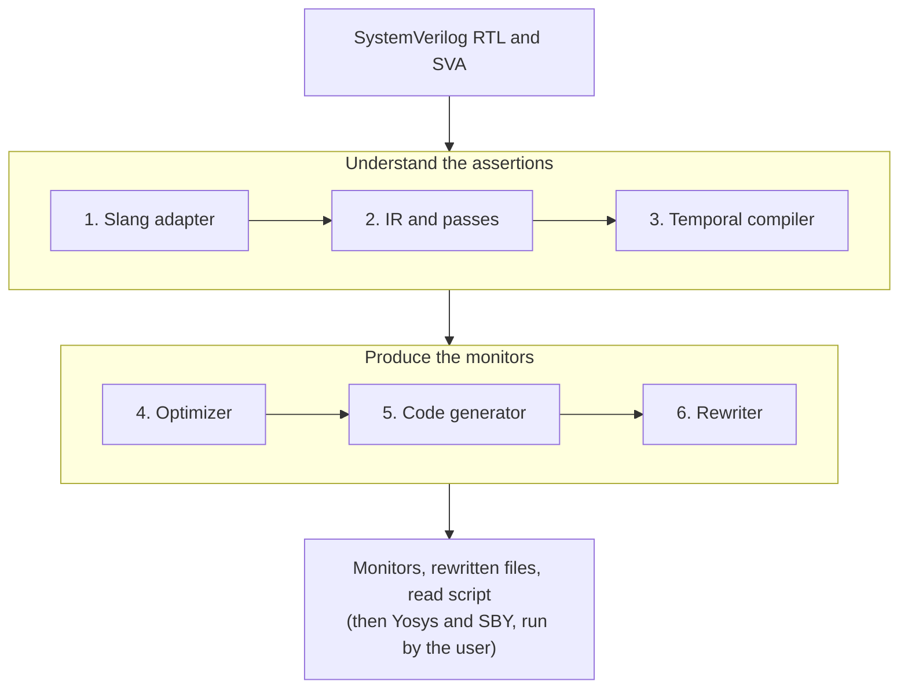

# Architecture

sva2yosys turns concurrent SystemVerilog assertions into ordinary SystemVerilog monitor modules that the unmodified Yosys and SymbiYosys flow can check. This document is for contributors. It explains how the tool is organised: the processing stages, the rules between them, the modules, how the source is rewritten, and what was learned about the two programs it depends on (Slang, which reads the input, and Yosys, which reads the output). For using the tool see [`usage.md`](usage.md), for the meaning of the properties [`semantics.md`](semantics.md), and for the evidence that the output is right [`validation.md`](validation.md).

The central idea is simple. Each assertion is compiled into an exact **temporal machine**: the state needed to decide the property sample by sample. The machine is written out as a small monitor module, and the assertion in the source is replaced by an instance of that module. Nothing is approximated: a construct that cannot be compiled exactly is rejected with a located diagnostic.

## Pipeline

The blocks, in order:

1. **Slang adapter** (`slang/`). Reads the design and verification files with Slang, through pyslang, and exports a subset of Slang's native AST JSON. `slang/convert` turns it into the typed IR. It is the only code that imports pyslang: after this block no Slang object is visible, and everything outside the supported subset is rejected here with a located message.
2. **IR and passes** (`ir/`, `passes/`). The IR is the canonical, Slang-independent form of expressions, sequences, properties, clocks and directives. The passes validate it (clock form, ranges, the first-sample rule for `$past`, supported shapes) and fold the X-checks that cannot matter.
3. **Temporal compiler** (`temporal/`). Rewrites the temporal operators into simpler forms, builds letter automata for the sequences, and compiles each directive into a Machine IR: the exact temporal state (frontiers, per-age obligation slots, match, failure and vacuity events, sampled-value history) together with its normative per-sample step. Shapes that the canonical machine does not cover exactly use a configuration-set machine or a per-attempt machine.
4. **Optimizer** (`optimize/`). Chooses a compact form for the monitor (direct, window or history) that behaves like the direct one; an SBY equivalence job checks that on selected properties.
5. **Code generator** (`codegen/`). Writes each machine as a monitor module in plain SystemVerilog. It mirrors the machine's `step` and decides no semantics.
6. **Rewriter** (`rewrite.py`). Replaces each assertion in the verification files by an instance of its monitor, lowers `bind` statements into generated copies of the target modules, and leaves everything else verbatim. The command line writes the files and a Yosys read script (`sva2yosys_read.ys`).

Yosys and SBY are then run by the user. sva2yosys itself never runs them.

## Boundaries

| Boundary | Rule |
|---|---|
| Slang adapter → rest | Only `src/sva2yosys/slang/` imports `pyslang`. It hands over typed IR, never Slang objects or raw dictionaries. |
| IR | Frozen dataclasses, `Enum` tags, `tuple` children. It describes **semantics only**: no registers, slots, histories or names. |
| Machine IR | Describes exact temporal state: frontiers, per-age obligation slots, events. Representation choices (counters, shift registers) do not appear before `optimize/`. |
| Codegen | Emits SystemVerilog only. It never decides semantics. |
| Product vs test tools | sva2yosys transforms SystemVerilog into SystemVerilog and runs no external tool. Yosys and SBY are used only by the tests, through `tests/support/toolchain.py` (tools named by variables; nothing looked up on `PATH`). |

## Test oracles

The **test oracles** live in `tests/support/`, outside the product, so that no product code can depend on them (`tests/unit_tests/test_package_boundaries.py` enforces it):
- the **reference evaluator** (`tests/support/reference/`): a direct, denotational implementation of the match semantics on finite traces, sharing only the IR with the compiler. Conditions are two-valued except at the first samples, where `$past` is X and the IEEE X rules apply ([`semantics.md`](semantics.md) §8). It is the oracle for the trace tables, the machine and the generated monitors' expressions (the layers of [`validation.md`](validation.md));
- the **machine simulator** (`tests/support/simulate.py`): runs the product's normative `temporal.machine.step` (and `temporal.attempts.step` for the per-attempt machine) over a trace.

Constant expressions are evaluated by Slang (`ASTContext.tryEval` in the exporter), never by a second evaluator in the product. A constant-false condition is an ordinary letter evaluated at its own sample by every machine ([`semantics.md`](semantics.md) §3); the automaton prunes only structurally dead letters.

## Modules

| Module | Role |
|---|---|
| `cli.py` | Command line ([`usage.md`](usage.md)): check mode (compile, validate, report each assertion with located rejections) and generate mode (`-o DIR`: the rewrite, the monitors file, the `sva2yosys_read.ys` read script carrying the `-D`/`-I` environment, and the `sva2yosys.f` file list). |
| `filelist.py` | `-f`/`-F` filelists: files, `-v`, `-y`, `--libext`, `-I`, `-D`, nesting. Unknown options are errors. |
| `slang/invoke.py`, `slang/export.py` | Compilation and design discovery with Slang's source loader (`-y`, `-v`), seeded with bind targets and `--top` names; the native-subset JSON export, with the `sva2yosys_*` records the later stages need (syntax inventory, includes, packages, and for every integral expression its width, signedness and packed dimensions, so that the converter never parses type strings). |
| `slang/dependencies.py` | Which visible parameters, type parameters and genvars the monitor of an assertion can depend on. |
| `slang/inside.py` | Helpers of the `inside` lowering (IEEE 1800 §11.4.13). |
| `slang/convert.py` | JSON to IR, with a located rejection for everything outside the supported subset. Also carries the directives that check nothing (`Skipped`) and the warnings for a dropped X part (`ConversionWarning`). `restrict` becomes an assumption (IEEE 1800 §16.14.4); the IR has no restrict node. |
| `ir/` | The IR: expressions, sequences, properties, clocks, directives, source positions. Some nodes exist only for the reference semantics (goto and non-consecutive repetition, `until`, unbounded `always` and `s_eventually`): the converter builds them, validation rejects them with a located message, and only the reference evaluator gives them meaning. |
| `passes/validate.py` | Validity of the IR at every consumer boundary (clock form, bounded ranges, nested sampled-value functions, select bounds, `$past` in an `if` condition, the first-sample rule) and the supported-shapes rules, including the cover rule. |
| `passes/x_checks.py` | Folds the Boolean skeleton of a directive that used `$isunknown` and decides whether anything is left to check ([`semantics.md`](semantics.md) §8a). |
| `passes/first_sample.py` | Static check that the first-sample rule for `$past` equals IEEE 1800. |
| `passes/frontend.py` | Rules of the Yosys frontend that reads the generated files (`--yosys-frontend`). |
| `temporal/lower.py` | Rewrites the temporal operators (`nexttime`, `always`, `eventually`, weak `until`, `if`) into sequence and implication forms, so that fewer shapes reach the machines. |
| `temporal/automaton.py`, `temporal/bounds.py` | Letter automata of sequences (ranges, repetition, `and`, `or`, `intersect`, `within`, `throughout`) and their duration bounds, computed from range ends without iterating over a range. |
| `temporal/machine.py` | The canonical machine and its normative per-sample `step`. |
| `temporal/attempts.py`, `temporal/netlist.py`, `temporal/life.py` | The per-attempt machine, for shapes the canonical machine does not cover exactly: one Boolean netlist per root age of an attempt, within the budgets. |
| `temporal/configurations.py`, `temporal/liveness.py` | The configuration-set machine for weak unbounded consequents, and the liveness kinds (pending bit or witness) of strong unbounded parts. |
| `temporal/nonvacuity.py` | Nonvacuity analysis of the property as written, and the cover rule. |
| `temporal/budgets.py` | The compile-time budgets and resource limits ([Resource limits](#resource-limits)). |
| `temporal/compile.py` | The entry point: per directive part, the canonical machine where it is exact, else the configuration or per-attempt machine. |
| `optimize/forms.py` | The monitor forms (`direct`, `window`, `history`), their applicability and size, and the choice between them ([`strategies.md`](strategies.md)). |
| `codegen/systemverilog.py` | The public entry points of code generation; dispatches on the machine representation. A new representation is one more `emit_*` module and one more case here. |
| `codegen/core.py` | What every monitor shares: the module shell (ports `clk`, `i0…`, outputs `fail`/`success`, parameter `CHECK`), one typed wire per IR node, the `valid` first-sample flag, history registers (never cleared by `disable iff`), state registers (cleared by it), and the header comments. |
| `codegen/emit_slots.py`, `codegen/direct.py`, `codegen/frontier.py` | Emitters of the canonical machine in its forms (the packed `direct` layout, `window`, `history`) and the letter-frontier helpers they share. |
| `codegen/emit_configurations.py`, `codegen/emit_attempts.py` | Emitters of the configuration-set and per-attempt machines. A liveness part adds, inside `` `ifdef SVA2YOSYS_LIVE ``, the `s_eventually` check read only by the liveness flow. |
| `codegen/expressions.py` | Bounded Boolean joins and typed concatenations: groups hold at most eight operands, larger ones use exactly sized `join<N>` wires, so that the local syntax depth stays at most 32 whatever the sequence ranges. |
| `codegen/render.py`, `codegen/resources.py`, `codegen/equivalence.py` | Human-readable comments (never semantics); the emission-size guard; the SBY equivalence job (a miter of the direct monitor and an optimised one). |
| `rewrite.py` | The syntax-inventory reader and the pure source rewrite described under [Source rewriting](#source-rewriting). |

The code generator mirrors the normative `step` of each machine and decides no semantics; both are checked against the oracles.

## Source rewriting

**Workflow.** The inputs are split in two:
- **design files** (the RTL): found by Slang's library search (`-y DIR`: only the files that are needed, starting from bind targets and `--top`), or listed (`-v`, filelists); compiled for elaboration context. **Original RTL inputs are never modified; generated copies may contain inserted verification instances.** A design file appears in the output only as such a copy, when a `bind` is lowered into one of its modules (below);
- **verification files** (the files the user designates): SVA properties plus any supporting SystemVerilog (property modules or checkers-as-modules, glue logic, `bind` statements that attach them to the design). Only these are translated.

The design usually reaches the verification code through `bind`, so the RTL stays untouched.

Within a verification file, the output is the file with:
- every supported concurrent directive replaced, at its Slang source range, by an instance of its generated monitor module (line numbers preserved);
  - a directive inside a procedural block cannot hold an instance: it becomes a null statement `;`, and its instance is inserted right after the outermost enclosing `always` block, on that block's last line (the exporter gives the offset as the inventory item's `sva2yosys_insertAt`);
- every skipped X-check (`Conversion.skipped`, [`semantics.md`](semantics.md) §8a) replaced by a comment (in an empty generate block, or after `;` in a procedural block; guarded by the parameter values of its instances like a monitor site), line breaks kept, no monitor; one `note` per site in `Rewrite.skipped`; a site whose instances disagree is an error;
- SVA-only declarations removed (`property`, `sequence`, `default clocking`, `default disable iff`);
- `bind` statements removed and lowered (below);
- **everything else preserved verbatim**;
- the monitor modules in a separate generated file.

Rules:
- Only constructs that can be neither lowered nor safely retained are rejected. An unsupported concurrent directive in a verification file is an **error**, never passed through. A concurrent assertion in a verification file that Slang did not elaborate (an uninstantiated module or generate branch), or that comes from a macro expansion or an included file, is an error too.
- **Property `and`.** A property `and` of non-sequences has no single machine: `temporal.compile.conjunct_directives` splits the directive into one directive per conjunct, and the rewrite emits one monitor instance per conjunct, wrapped in one generate block (`if (1'b1) begin : __sva2yosys_p<N>_and ... end`) so that it stays one statement under an unbraced `if` or loop.
- **Per-instance monitors.** All elaborated instances of an assertion (instances of its module, iterations of a generate loop) share its monitor when they all give the same one; otherwise the site selects between variants:
  - When no parameter or genvar is visible at the site, all instances are spliced once, as one monitor (they must then all give the same monitor).
  - Otherwise each distinct monitor is a module, and the site becomes a `generate if` chain comparing the visible parameters, type parameters and genvars *that the monitor can depend on*: each branch holds for exactly the value combinations of its variant's instances. A final `else` branch holds an always-failing assertion, so a module elaborated with any other combination fails loudly instead of checking another instance's monitor.
  - The exporter records the values per assertion (`sva2yosys_parameters`; `null` for a non-integral value, a type, an interface port, or a declaration in another compilation unit). The conversion rejects those in check mode and in generation alike, as it does escaped names (one shared rule, `ir.directive.uncomparable_parameters`). A parameter whose declaration fixes no width (`parameter P = 1`) takes its type from the value, so its branch condition also compares `$bits(P)` and its signedness.
  - **Dependencies** (`slang/dependencies.py`). The exporter computes, per assertion, the visible parameters, type parameters and genvars the monitor can depend on (`sva2yosys_dependencies`): those referenced by the property, the `disable iff` condition, the clock and the enabling condition, by the bodies of the named properties, sequences and module-local functions it uses, and by the declared types and port dimensions of the signals it reads. A syntax scan of every identifier catches the folded constants (`##LP`, `[*N]`, casts `W'(x)`, `$bits(T)`) that vanish from the bound expression. Only these key the monitor: a parameter that cannot change it (for example a struct parameter that only decides, in an enclosing generate `if`, whether the assertion exists) neither selects the monitor nor makes the assertion unsupported.
  - The analysis is conservative: a reference it cannot classify (a hierarchical reference, an interface port, a checker, a class, an unhandled symbol kind, a name outside the visible list) makes the set unknown, and then every visible parameter counts. A dependency missed among the instances seen is still a loud error ("the values do not determine the variant").
  - Two cases are rejected: a struct parameter that the assertion depends on (its members are not compared separately), and a dependency that the assertion's position hides behind another declaration (an inner generate block redeclares `D`, which a named property declared outside it uses; recorded as `sva2yosys_hiddenParameters`). The explicit type of a parameter (`localparam logic [W-1:0] LP`, whose `$bits` depends on `W`) is followed.
- **Connections by name.** A monitor instance connects each signal by its simple name, written where the assertion was. That is exact only if the name means the same symbol there. Names in `default clocking`, `default disable iff`, `property`/`sequence` declarations and checker bodies resolve where those are declared, so the exporter looks each name up from the assertion's scope (`sva2yosys_visibleAtSite`). The converter rejects the assertion when the lookup finds a different symbol (e.g. a generate block that redeclares `rst`), or when the name is a checker formal.
- **SVA in design files is an error in generation.** Design files are not translated, so any SVA item in one would reach Yosys unchanged: `read_verilog` applies its own SVA semantics, or none, and does not support `bind` (a syntax error since Yosys 0.70). This covers assertions (elaborated or not), declarations, clocking blocks, binds and checkers, also through an `include`. The fix is to move it into a verification file, or to pass that file as a verification file (a positional argument). `--allow-design-sva` turns the error into a warning for users who accept Yosys's handling.
- **Live read scripts.** When some monitor has a liveness part (`Rewrite.live`), the CLI also writes `sva2yosys_read_live.ys`, the same read commands with `-DSVA2YOSYS_LIVE` (every part), and, for each `assert` liveness part (`Rewrite.live_monitors`), `sva2yosys_read_live_<part>.ys` with `-DSVA2YOSYS_LIVE_<part>` (plus `-DSVA2YOSYS_LIVE_FAIR` when `Rewrite.fair`): SBY's `live` mode decides a task by its first justice verdict, so each part has a task of its own; the `prove` task reads `sva2yosys_read.ys` and sees the safety monitors only.
- **Preprocessing environment.** The output is read with the generated `sva2yosys_read.ys`: one `read_verilog -formal -sv` per file, with the same `-D` definitions and `-I` directories as the Slang compilation. A relocated (written) file first gets its original directory, so its relative includes resolve as before. Output that would make an include find a different file in the output directory is refused.
- **The `slang` frontend** (`--yosys-frontend slang`). `rewrite(..., frontend=SLANG)` keeps the `bind` statements and copies no design file; the CLI writes `plugin -i slang` and one `read_slang --best-effort-hierarchy --allow-use-before-declare -D FORMAL …` command (the same `-D` and `-I`, one `--top` each, the monitors then the inputs in reading order) and no live script. `--top` is required.
- **`bind` is lowered** (default frontend). `read_verilog` does not support `bind` (a syntax error since Yosys 0.70; earlier versions silently ignored it, which would have dropped every bound monitor without a message), so a bind is not kept verbatim. Each `bind` in a verification file is therefore lowered to an explicit instance, so the output runs with plain `read_verilog -formal -sv` under SBY:
  - The `bind` statement is removed from the verification file.
  - The bound instance (its text from the bind, with its parameters and port connections) is inserted just before `endmodule` of the target module. Bind port expressions are resolved in the target's scope (§23.11), which is exactly the scope of an instance written there.
  - That target module is written to the output as a **generated copy** of its design file. The original RTL files are never modified, and the copy differs from the original only by the inserted lines.
  - A module-type bind (which applies to every instance of its target module) is accepted. Instance binds, including a list that covers every instance, are rejected before either frontend is selected.
- The generated monitors stay within the portable subset that both `read_verilog` and `read_slang` read.
- Generated names are deterministic: `__sva2yosys_p<N>…`. Each monitor carries a comment with the source location and the original text.

**Fairness assumptions.** `compile.is_fairness_assumption` identifies accepted assumption monitors with a liveness part. The CLI check and the rewriter collect accepted covers across the run and attach `COVER_FAIRNESS_WARNING` at each cover if any fairness assumption was accepted. Such an assumption also sets `Rewrite.live`, so the live read script is emitted even without a strong assertion. The ordinary prove/cover read script omits fairness; the consequences and the manual cover confirmation are in [`usage.md`](usage.md).

## Resource limits

A property must not make the compiler allocate unreasonable state, so compilation is bounded in three places:
- `temporal.budgets.Budgets` bound the per-attempt and configuration machines (letters, instances, registers, gates, configurations). A letter-count estimate on the property as written runs before construction.
- `temporal.budgets.ResourceLimits` is an immutable policy checked on the written IR before lowering and validation, through every compiler entry point and the rewrite, and charged for the graph and netlist work before it is allocated.
- `codegen.resources.check_emission` independently guards the selected representation and the expression and history expansion before any RTL is built. It counts a conservative structural allowance, not a Yosys gate count.

The check mode and the rewrite share these checks, and diagnostics are located at the directive. The policy starts after Slang elaboration; its defaults and overrides are in [`usage.md`](usage.md). Automaton construction and frontier evaluation are linear in positions plus edges: each automaton computes its incoming edges once.

## External tools

Tests that use Yosys, SBY, EBMC, Spot, Verilator, the slang executable or a third-party corpus are opt-in. They are selected with command-line switches and located by variables kept in a git-ignored `.env`; see [`.env.example`](../.env.example) and [`validation.md`](validation.md) §7.
## Slang frontend findings

These findings come from probing the elaborated AST with pyslang 12.0.0 on the fixtures in `tests/functional_tests/slang_frontend/fixtures/`.

**JSON format.** pyslang does **not** expose Slang's AST serializer (`--ast-json` exists only in the slang executable). Syntax nodes have `to_json()`, but they are not elaborated. sva2yosys therefore writes its own exporter that emits a **subset of Slang's native `--ast-json` format**, with the same node `kind`s, key names and source-range keys:
- `AssertionExpr`: `"kind"`, plus `"expr"`, `"repetition"` (`{"kind", "min", "max"}`), `"elements"` (`[{"sequence", "min", "max"}]`), `"op"`, `"left"`/`"right"`, `"clocking"`, `"condition"`, …
- the `"max"` of an unbounded range is `"$"`;
- source ranges are given as `source_file_start`/`_end`, `source_line_start`/`_end` and `source_column_start`/`_end`.

This is verified, not assumed: an opt-in contract test (`SVA2YOSYS_SLANG`) checks that every exported record is a subset of the slang executable's native output for all fixtures. The only differences are our `sva2yosys_*` keys and `symbol`, which native Slang writes as `"<address> <name>"`.

**What Slang already resolves** (we don't re-implement it):

| Need | Where it comes from |
|---|---|
| Assertion structure | `ConcurrentAssertionStatement.propertySpec`: `ClockingAssertionExpr`, `BinaryAssertionExpr` (`OverlappedImplication`/`NonOverlappedImplication`), `SequenceConcatExpr` (elements with `delay.min`/`max`; a leading `##0` element for `b ##[1:3] c`), `SimpleAssertionExpr.repetition`, `DisableIffAssertionExpr` |
| Default clocking, and the clock of a procedural assertion inferred from its `always` block (§16.14.6.1) | `analysis.AnalysisManager().getAnalyzedAssertions(proc)[i].semanticLeadingClock` (per procedural block) |
| Drivers of a signal (for the stability of a procedural enabling condition) | `AnalysisManager.getDrivers(symbol)`: kind (procedural/continuous), flags (input/output port, initializer), the containing block or continuous assignment; whether a procedural write is nonblocking comes from `AssignmentExpression.isNonBlocking` in that block. A net's declaration initializer (`wire w = e`) has no driver record and is read from `NetSymbol.initializer` |
| Named sequences and properties with arguments | `AssertionInstanceExpression.body` is already **argument-substituted**: formal `r` resolves to the net `top.u3.req` |
| Per-instance parameters | delay and repetition ranges are folded per instance (`##[1:N]` gives `[1:3]` in `u3` and `[1:5]` in `u5`) |
| Checkers | `CheckerInstanceSymbol`; arguments substituted |
| `bind` | bound instances elaborated in the target hierarchy |
| Hierarchical references | `HierarchicalValueExpression` |
| Source locations | `sourceRange` on expressions and statements, via `SourceManager` |

**Gaps and workarounds:**

The [frontend boundary fixture](../tests/functional_tests/slang_frontend/fixtures/support_boundaries.sv)
separates usable export from converter admission. Negative/
iff clocks, both clocks of a multiclock implication, gated past, nested sampled
calls, sequence-triggered calls and package-qualified substituted bodies retain
their relevant structure even when later stages reject them. First-match has a
located unsupported export stub; explicitly clocked past also retains unsupported
`EmptyArgument`/`ClockingEvent` stubs. These observations explain the frontend
column of the support matrix without claiming monitor support.

- **Default `disable iff`.** pyslang has no accessor (Slang's `getDefaultDisable` is not bound). Workaround: a probe compilation in which each `default disable iff (e);` is replaced by an assertion with an explicit `disable iff (e)`, so that Slang itself binds `e` in the same scope. No name resolution is re-implemented.
- **Identical instances.** Slang's assertion analysis (which provides the semantic leading clock) reports an assertion for only one of several instances with identical bodies, even with instance caching disabled; pyslang cannot turn the caching off, because it exposes `CompilationFlags` as an `IntEnum`, so flags cannot be combined. Workaround: an instance without an analysis result takes the clock of its analyzed twin (the assertion at the same source position and in the same generate iteration relative to the instance, since all iterations of a generate loop share a source position), with the twin's instance path rewritten to its own. This is accepted only if the exported properties are identical under the same rewrite; otherwise the export fails with `InconsistentInstanceAnalysis`. Slang itself is not rebuilt.
- **`AssertionInstanceExpression.arguments`** cannot be converted by the binding (it is a C++ `std::variant`). It isn't needed, because bodies are already substituted.
- **Checkers.** The source ranges of checker assertions point into the checker declaration, and free Yosys does not support checkers. Their monitors would have to be placed at the checker *instance*; checkers are rejected today.
- **Formal-argument source ranges** point at the formal's text inside the declaration. They are fine for diagnostics, but code generation must render names from **symbols**, never from source text.

## Yosys frontend findings

These findings were obtained with Yosys 0.63 and 0.70 and the yosys-slang plugin, and are pinned by the Yosys contract (`tests/functional_tests/yosys_contract/CONTRACT.md`).

| Topic | `read_verilog -formal -sv` (RV) | `read_slang -D FORMAL` (RS) |
|---|---|---|
| Monitor subset (initial values, asynchronous clear, `always @*`/`@(posedge)` assert/cover) | ✅ | ✅ |
| Formal cells | `$check` (untriggered), `$adff` | identical `$check`; `$aldff` for the asynchronous clear |
| SBY results on the contract monitor | reference | identical (failure step, proof, cover steps) |
| Names in SBY reports | hierarchical (`top.u_mon._witness_…`) | flattened (`top._witness_.check_N`); source locations kept. With `--best-effort-hierarchy`: hierarchical, as RV (generate blocks are named differently) |
| Concurrent SVA | ❌ syntax error (clocked `assert property (@(posedge clk) …)`); the one exception: inside `always @(posedge clk)`, `assert property (s_eventually e)` with a Boolean `e` gives a `$check` cell with `FLAVOR "live"` (Yosys 0.63, checked by hand) | ◐ Boolean assertions (module-level with an explicit clock, or procedural) are accepted on the pinned Yosys 0.70; implication, delays and `eventually` are rejected as "SVA unsupported" (`--ignore-assertions` would drop our checks too) |
| `$global_clock` | ✅ `$ff` (Yosys extension) | ❌ requires `global clocking`, which yosys-slang does not lower |
| `bind` | ❌ syntax error since Yosys 0.70; **silently ignored** before (parsed into objects that nothing applies) | ✅ module and instance binds |
| `$anyseq` call (liveness witness) | ✅ | ❌ "unknown system name"; the attribute `(* anyseq *)` is accepted |
| A register read before its declaration (the history registers of a monitor) | ✅ | ❌ unless `--allow-use-before-declare` |
| Full SystemVerilog RTL (interfaces, packages, structs) | limited | ✅ |

Consequences:
1. **Neither frontend lowers the temporal operators of concurrent SVA** (`read_slang` reads only Boolean assertions), so the output must contain none.
2. **Generated monitor code stays within the portable subset**: no `$global_clock`, no `bind`. Any frontend can then read it, with two exceptions: the liveness parts (`assert property (s_eventually e)`, `$anyseq`) are read by RV only, and RS needs `--allow-use-before-declare` for the history registers. User RTL can be read by RS, while global-clock testbenches stay on RV (mixed sessions work).
3. **Monitors are placed as module instances, not via `bind`.** Each concurrent directive is replaced in place by an instance of a generated monitor module. Port expressions are evaluated in the original scope, so parameters, generate scopes and per-instance values resolve naturally.
4. **User `bind` statements** in verification files are lowered to explicit instances in generated copies of the target modules, so the output needs no `bind` support (see [Source rewriting](#source-rewriting)). With `--yosys-frontend slang` they are kept and read by RS, which applies them; a liveness part is then rejected (`passes/frontend.py`, one rule for check mode and generation).
5. **Check placement depends on SBY's clock mode**, not on the frontend: `always @*` for `multiclock off`, `always @(posedge clk)` for `multiclock on`.

Findings about tools that the product does not depend on (EBMC, Verilator, the public corpora) are in [What we learned from other tools and corpora](tool-comparison.md#what-we-learned-from-other-tools-and-corpora).
